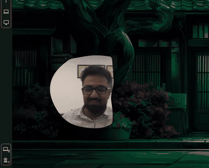
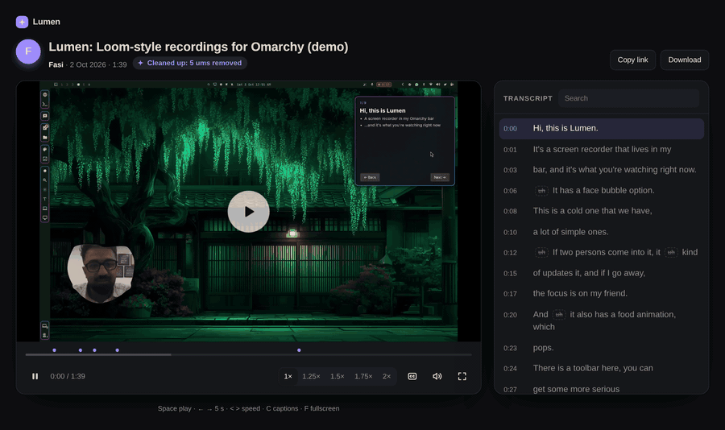
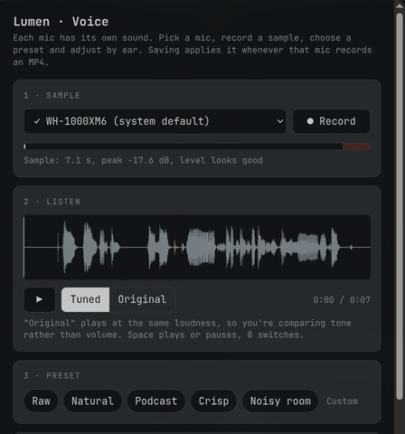
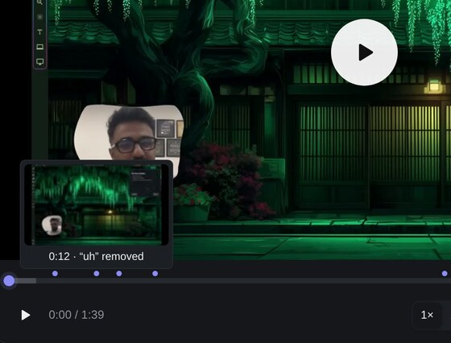
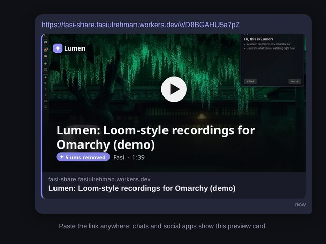

# ✦ Lumen

**Loom-style screen recordings for Omarchy, without the subscription.**

Click the ✦ in your top bar, record your screen with your voice and your face in a bubble, and when you stop, the ums and long pauses are already cut out and a share link is on your clipboard. Every recording is an **MP4 file on your computer**, shared or not; share links add a copy in **your own** Cloudflare account, which is free for most people.

<p align="center"></p>

<p align="center">▶ <a href="https://fasi-share.fasiulrehman.workers.dev/v/D8BGAHU5a7pZ"><b>Watch the demo (1:39)</b></a>, recorded and shared with Lumen itself</p>

## What it does

- **Records** an area you drag, one window, or a whole screen, as MP4 (or GIF).
- **Your file, always.** Every recording is saved as an MP4 in `~/Videos`, even when you share it, plus the uncut version when ums are removed. There's nothing to download back from a cloud, and it's yours to edit, keep or post anywhere.
- **Your mic**, optionally mixed with what the computer plays.
- **Removes ums and long pauses** automatically. The speech AI runs on your NVIDIA card, on your own Cloudflare account, or on your processor, and you choose where. The uncut recording is always kept.
- **Share links the moment you stop.** The link is copied before the upload even finishes. The page has a proper player, a clickable transcript, chapters, an optional password and expiry, and view counts, with a dashboard for all your videos.
- **Face bubble (beta)**: your webcam in a bubble that follows your outline, reaches for your hands and is recorded with everything else. Hover it to change its size, shape and outline.
- **Titles and summaries** written by AI for every shared video.

| Two people? The bubble joins you, then pops | Hover the bubble to restyle it | The share page |
|---|---|---|
|  |  |  |

## The little things



- **Your mic, made to sound good.** Pick a sound right under the mic: Natural, Podcast, Crisp or Noisy room. Or fine-tune it by ear: record a few seconds, then flip between *Tuned* and *Original*, played at the same loudness so you hear the tone, not the volume. Each mic keeps its own sound, so your headset and your webcam mic can be tuned differently.
- **Ums in more than one language.** Lumen cuts English hesitations and the usual Urdu and Hindi ones. It never cuts real words like "like" or "so", and it listens again afterwards to check nothing was missed.
- **The bubble listens.** While you record, it ripples gently as you talk.
- **The link comes first.** It's on your clipboard the moment you stop, while Lumen is still saving and uploading.
- **GIF mode** for quick loops: silent, and it pastes into any chat as an image.
- **Small conveniences:** a live "about 20 MB per minute" estimate, AV1 for files about a third of the size, and if the screen you picked is unplugged, it records the one you're on.

<br clear="right">

**The share page**



- **You can see what was cut.** Purple dots on the timeline mark each removed "um", and hovering one tells you which. The transcript shows them struck through.
- **Hover previews** on the timeline, like YouTube.
- **Search the transcript**, then click a line to jump there. Captions, AI chapters, speeds up to 2×, and keyboard shortcuts (space, ← →, < >, C, F).
- **It looks right when pasted.** Chat and social apps show a preview card with the title and how many ums were cut. Those link previews and bots don't count as views, so the view count is real people.

<br clear="right">

<p align="center"></p>

## Why Lumen, not Loom?

Loom is great, but on Linux it doesn't exist: Loom only makes desktop apps for Windows and Mac, and doesn't support its Chrome extension on Linux. And the parts that make Loom videos nice to watch cost extra.

| | **Lumen** | **Loom** |
|---|---|---|
| **Runs on Linux / Omarchy** | Yes, natively in your top bar | No |
| **Price** | Free¹ | Free plan, or $18–24 per person per month ($15–20 paid yearly) |
| **Video length and count** | No limit from Lumen (your Cloudflare storage: 10 GB free) | Free plan: 5 minutes, 25 videos |
| **Removes ums and long pauses** | Included | Only on Business + AI ($20–24 per person per month) |
| **AI titles, summaries, chapters** | Included | Only on Business + AI |
| **Where your videos live** | An MP4 on your computer, always; share links add a copy in your own Cloudflare account | Loom's servers |
| **Speech AI can run on your own machine** | Yes | No |
| **Open source** | Yes (MIT) | No |

**When Loom is the better choice:** if your whole team shares a workspace, wants comments and reactions on videos, uses Windows or Mac apps, or needs editing tools, Loom does those things and Lumen doesn't (yet). Lumen is for recording a clear video on your own Linux machine and sending a link, without paying for it or handing your videos to someone else.

¹ Lumen itself is free. Share links use your own Cloudflare account. Its free tier covers 10 GB of videos and about 214 minutes a day of speech AI, and beyond that Cloudflare charges $0.015 per GB per month for storage and $0.0005 per minute of speech. Cloudflare asks for a card or PayPal before it switches storage on (usage isn't capped), so keep an eye on its dashboard if you record a lot. Without share links, nothing goes to Cloudflare at all.

<sub>Loom details from [loom.com/pricing](https://www.loom.com/pricing) and [Loom's device compatibility page](https://support.atlassian.com/loom/docs/loom-device-compatibility/); Cloudflare from its [R2](https://developers.cloudflare.com/r2/pricing/) and [Workers AI](https://developers.cloudflare.com/workers-ai/platform/pricing/) pricing pages. Checked October 2026.</sub>

## Install

You need [Omarchy](https://omarchy.org) 4.

```
omarchy plugin add https://github.com/fasi96/lumen --enable
```

That's it: click the **✦** in the bar and **Start recording**. Recording needs nothing else; everything it uses ships with Omarchy, and no account is needed.

### Add-ons (optional)

Switch any of these on in the popup and Lumen installs what that one needs, the first time (a small terminal opens, says what it will install and asks first):

| Add-on | What it installs |
|---|---|
| **Remove ums & pauses** | A speech AI: `uv` (if missing) and its Python packages, plus a 1.6 GB speech model. About 2 GB, or 4 GB with an NVIDIA card. Or ~80 MB if it runs on your Cloudflare. |
| **Face bubble (beta)** | The camera AI's Python packages (about 0.5 GB) |
| **Share links** | A share site in **your own** Cloudflare account; `nodejs` and `npm` to publish it |

**Settings → Add-ons…** in the popup shows the same list as a checklist, plus two more: the **Shift+Alt+Print** shortcut (also one click in **Settings**) and terminal commands in `~/.local/bin` (`lumen`, `lumen setup`, …).

### Share links need a (free) Cloudflare account

When you switch share links on, setup creates everything in **your** account: storage for the videos (R2), a small database, and the share site. It walks you through signing in. Cloudflare's free tier covers 10 GB of videos and about 214 minutes a day of speech AI. Cloudflare needs a card or PayPal on file before it turns storage on, even for the free tier. Lumen's author has no access to your account or your videos.

## Use it

| | |
|---|---|
| **Record** | Click ✦ → **Start recording** (or **Shift+Alt+Print**, once you've added the shortcut) |
| **Stop** | Click the red timer in the bar, or press the shortcut again |
| **Your last recording** | At the bottom of the popup: open, copy, share, show in folder |
| **Shared videos** | Settings → **Shared videos…** (rename, password, delete, views) |
| **Face bubble** | Drag to move it, scroll to resize it, hover it for the toolbar. *Center me* (under the Face bubble switch) frames you |

Once you've added the terminal commands (Settings → Add-ons…), `lumen help` lists everything: `lumen record`, `lumen stop`, `lumen share list`, `lumen cam center`, …

## Privacy

- Recordings are saved in `~/Videos`. Nothing is uploaded unless you turn on share links.
- With **"This computer only"**, your audio never leaves your machine.
- With share links, videos and transcripts go only to **your** Cloudflare account. Anyone who has a link can watch that video, so set a password on anything private.
- With **"This computer only"**, AI titles are only written if the local model can run on your machine; otherwise the video keeps a plain title. Nothing is sent to Cloudflare's AI.
- Lumen has no servers, accounts or analytics of its own.

## Known limitations

- **Graphics:** the main recorder needs Intel, AMD or NVIDIA graphics. Elsewhere (for example in a virtual machine), Lumen switches to a backup recorder automatically once it's installed (Lumen tells you if it's needed, and how). The backup records your mic but **not desktop sound**.
- **Um removal without an NVIDIA card** runs on Cloudflare or your processor. On the processor it took about **3× longer** than on an NVIDIA card in our test, with the same result.
- **The face bubble is in beta.** It uses roughly one processor core while it's open.
- **Two people far apart** in the face bubble each show as half a person.
- Big **4K at 60 fps** recordings take a while to save. The default (1080p, 30 fps) saves about 3× faster.

## Uninstall

```
~/.config/omarchy/plugins/io.github.fasi96.lumen/setup/setup.sh uninstall
```

(or `lumen uninstall` if you added the terminal commands). Run it **before** `omarchy plugin remove io.github.fasi96.lumen`; it removes the bar plugin too. If you already removed the plugin, run `~/.local/share/lumen/uninstaller/setup.sh uninstall` (that copy exists once any add-on was set up; if you never added one, only small settings files in `~/.config/gif-record` and `~/.cache/gif-record` are left behind). It removes exactly what setup added, using the record setup keeps in `~/.config/lumen/installed.json`:

- the speech AI and, if Lumen downloaded it, the speech model;
- the shortcut block in your Hyprland bindings (left alone if you've edited it);
- the terminal commands it linked (never ones that were yours);
- Lumen's working files, and, if you say yes, your settings and your list of shared videos;
- the bar plugin.

**Your recordings are never touched**; unfinished ones from a crash are moved to `~/Videos/Lumen leftovers`. Your Cloudflare share site stays unless you choose to delete it too. Shared tools are left as they are: uv's Python and package cache (`uv cache clean`) and wrangler's Cloudflare sign-in (`wrangler logout`).

## What it uses

Recording uses only what Omarchy ships: `gpu-screen-recorder`, `ffmpeg`, `slurp`, `jq`, `wl-clipboard`, `pactl` (libpulse), `gum`, `chromium` (the mic tuner's window). Everything below is installed only when you switch the add-on on, and only after you say yes:

- **Arch packages** (with `sudo pacman -S --needed`, which asks for your password): `uv` (speech AI, face bubble), `gtk4-layer-shell` and `python-gobject` (face bubble; Omarchy usually has them), `nodejs` and `npm` (share links), `wf-recorder` (backup recorder for graphics the main one can't use: `lumen setup recorder`).
- **Python packages**, exact versions with checked hashes: `setup/requirements-*.lock` (speech AI, in `~/.local/share/lumen/venv`) and `cam/lumen_cam.py.lock` (face bubble, in uv's cache). uv downloads its own copy of Python 3.12 if your system doesn't have it.
- **The speech model**: [faster-whisper large-v3-turbo](https://huggingface.co/dropbox-dash/faster-whisper-large-v3-turbo) at a pinned revision, 1.6 GB, from Hugging Face.
- **The face bubble's models**: two MediaPipe models, bundled (see `cam/models/NOTICE.md`).
- **Share links**: `wrangler` (Cloudflare's CLI, exact version from `share/package-lock.json`, installed with `npm ci`). In your Cloudflare account it creates a Worker, an R2 bucket and a D1 database, sets two secrets (`ADMIN_TOKEN`, `PASSWORD_SALT`), and uses Workers AI when the speech AI runs on Cloudflare.

## Contributing

See [docs/DEVELOPING.md](docs/DEVELOPING.md) for how the code is laid out. Bug reports and pull requests are welcome.

## Licence

[MIT](LICENSE)
